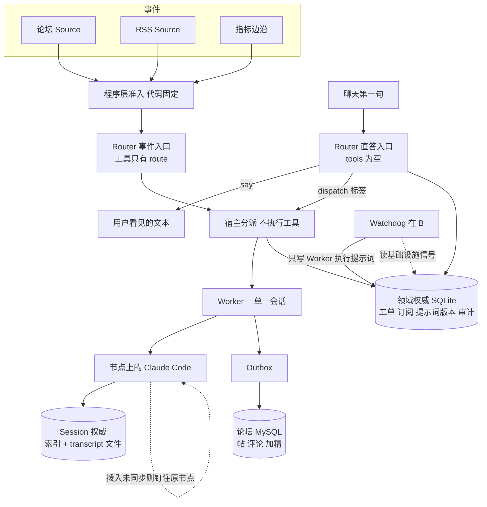
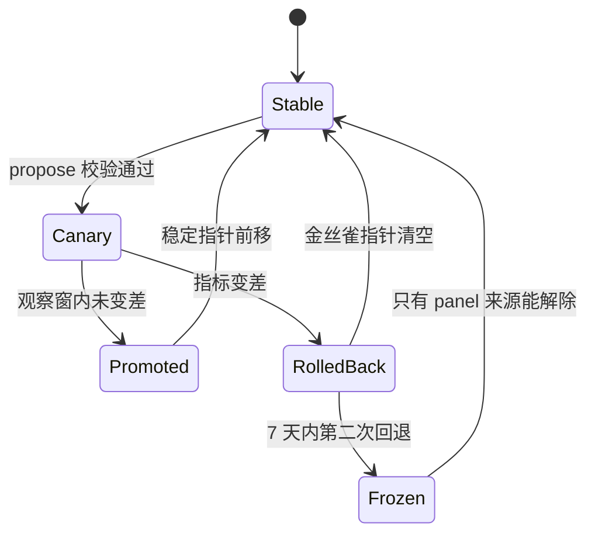

# 架构

> 2026-11-18 · 三条已定裁决：Router 空工具直答、Watchdog 允许自动改词、补 transcript 同步。
> 实现状态见 [README](../README.md) 与 [migration.md](migration.md)。

三条裁决按约束写进架构。先核对原型里提示词版本和雁阵会话落盘的实际接口，保证实现设计能对上现有结构。

三条裁决已经收进架构。直答靠两个入口和返回校验拦住工具，Watchdog 只能改 Worker 的执行提示词并且先走金丝雀，Claude Code 的会话按轮次把 transcript 同步到 Session 库。同步确认之前，拨入节点仍然钉在原节点。跑在 deploy 里的回合，未同步即作废。

## 1. 总图

聊天直答不经过事件入口。两个入口的工具列表在代码里是两种不同类型，没有共用的 `chat(messages, tools)`。

## 2. 组件

| 角色 | 语言 | 部署 | 权威 | 挂了怎样 |
| --- | --- | --- | --- | --- |
| 论坛 | Go，现有进程 | A | 论坛 MySQL：帖、评论、加精 | Outbox 按回执重试，不另开一份帖子库 |
| Router 宿主 | Python，一个进程 | A | 不持有权威，只写领域库和 Outbox | 新的直答和分派停止；节点上已经跑着的 cc 回合跑完；B 上的 Watchdog 仍能告警 |
| 程序层准入 | 同上，进程内代码 | A | 规则在代码里，不在提示词里 | 与 Router 宿主同生同死 |
| 领域库 | SQLite | A 的一个文件 | 工单、Thread、订阅、Decision、派工、Outbox 回执、提示词修订、审计 | Router 停止写入；不把工单迁到别处顶上 |
| Session 库 | 索引行在领域库，正文是内容寻址文件 | A 的目录 | transcript、轮次、head sha、bundle | 拨入的原节点可继续；其他节点拒绝 `--resume`。deploy 上未确认的回合作废 |
| 节点 daemon | 现有 `node-agent.mjs`，只指拨入机器 | D、E，反向拨入 | 无。`node-state.json` 只是缓存。旧字段 `pod` 是自报机器名，不是 deploy id | 同步已确认的会话可换节点；未确认的工单钉在这台机器上等待 |
| Claude Code | 外部二进制 | 拨入节点本机，或一次性 deploy | 无 | 拨入节点上本轮进程失败则该轮结果作废，领域库保留派工记录。跑在 deploy 里的回合，未同步即作废 |
| Watchdog | Python，独立进程 | B | 无。写操作只打到 A 的一个接口 | 主系统照常；提示词停在当前稳定修订；基础设施告警暂停 |
| frp 托管服务 | 下游调用，不创建进程 | C，经 frp，不走 YatTerra | 无。模型与检索不在这里落权威 | 该次调用失败。这里不是 Worker 的放置目标 |
| YatTerra deploy | 平台预置环境，无自定义镜像、无 exec | C，被点名时。不要宿主能力（hostPath、hostNetwork、docker.sock） | 无。无持久盘，本地队列随 pod 消失 | 该次尝试失败，只能看 logs，不把论坛 token 或模型回退放进去。token 未就绪则不进关键路径 |

调度记在领域库，不记在 YatTerra。YatTerra 不是调度器，只是会限流、改版、宕机的执行后端。Bearer token 与 deploy 出网都未确认。token 未就绪，或出网仍未确认时，这一池不进关键路径，工单留在拨入节点。

| 态 | 领域库 |
| --- | --- |
| 提交失败 | 没拿到可信的 deploy id 就不记 running。鉴权失败或配额用尽记 `submit_failed` 并告警，停止空转。限流则退避。超时或中断记 `submit_unknown`，用调度器生成的 attempt 名对账：查到了转入下一态，窗口内查不到再重提。不假设对方有幂等键 |
| 提交成功但没起来 | 收到 2xx 立刻写下 deploy id，状态 `submitted`。之后只轮询 status 和 logs。超过启动时限就 stop，记 `start_failed`。下次用新的 deploy id |
| 起来了但结果没回写 | 成功只认 A 上的回执：transcript 确认、head、bundle 或补丁。status 只决定继续等还是 stop，exit 0 不算成功。到期仍无回执就 stop，记 `result_missing`。没有对外写权限时，允许新 deploy 用新 session 整段重做。这次尝试带了对外写权限，就停给人。新尝试开始后，旧 deploy 的晚到回写只进审计 |

原型 `prompts.ts` 第 200 行已经写明：提示词只改变模型听到的话，工具权限、准入和账号包装仍由宿主决定。下面三条都沿这个分界。

## 3. 裁决一：空工具直答

直答和分派分成两个构造函数，类型上不能混用。

`direct_reply(messages)` 的请求类型是 `{ messages, tools?: never }`。函数签名里没有 `tools` 参数。发出前只有一处校验 `freeze_router_request`：`direct` 分支要求正文里不存在 `tools`，或者 `tools` 是空数组；出现任何工具名就抛错，请求不发出。`dispatch` 这条函数不给聊天第一句用。事件批处理用另一个入口，工具名只允许 `route`、`attach`、`ignore`、`stop`、`note`，名单写死在校验里，Bash、读文件、SQL、发帖一律拒绝。

返回同样只过这一处校验。直答调用要求模型返回一个标签，没有第三种：

- `{ "action": "say", "text": "..." }`：文本原样交给 Outbox 或聊天通道。
- `{ "action": "dispatch" }`：宿主建派工。用户看见的第一句是代码里的固定字符串，不是模型现编的。

校验失败、出现 `tool_use` 或 `tool_calls`、或者 JSON 不合法，都按 `dispatch` 处理：丢弃模型想展示的正文，不执行任何工具调用。模型没法「顺便跑一下」。它也没法把一件需要工具的事说成很小，因为这条调用里根本没有工具可以选，只有两个标签。

事件入口上的 `route` 工具不会出现在直答请求里。所以聊天第一句最多一次模型调用。需要干活时，第二次调用发生在 Worker，不发生在 Router。

这个保证用测试钉住：构造 `direct_reply` 的请求，断言序列化结果里没有工具；喂一条带 `tool_use` 的伪造响应，断言用户看见的是代码里的固定字符串，不是模型正文，并且领域库里出现一条派工。

## 4. 裁决二：Watchdog 改提示词

改动沿用原型已有的版本结构。`Versions.save`（`src/app/versions.ts` 第 21–27 行）每次写入新修订并移动指针，旧修订留着。`Prompts.save`（`prompts.ts` 第 202–214 行）用 `baseRevision` 做乐观锁，冲突就拒绝。`savePrompts` 的生效点是下一次模型请求（同文件第 246 行），已经在跑的回合仍用旧文本。来源今天只有 `panel`、`tool`、`sync`（`policy.ts` 第 109 行）。增加一个来源 `watchdog`，不复用 `tool`。

可改的键，只限 Worker 角色单独阅读的执行段，对应 `prompts.ts` 第 56–62 行里 `roles` 只有 worker 的部分：

- `runtime/worker`
- `runtime/work`
- `runtime/handoff/worker`

不可改：

- `runtime/admission`、`runtime/policy`、`runtime/policy/none`：准入与策略
- `runtime/orchestrator`、`runtime/dispatch`、`runtime/handoff/orchestrator`：Router 自身
- `runtime/shared`、`runtime/replies`、`runtime/subscriptions`：两个角色一起读的段落
- `skill/feishu`、`skill/github` 以及任何团队技能
- 团队段 `communication`、`scope`、`delivery`：它们决定对外措辞和交付条件
- 直答入口的标签协议、两个入口的工具名单：在代码里，不在提示词家族里
- 准入矩阵、允许名单、阻塞命令、Source 配置
- Watchdog 自己的提示词：随程序发布，文件对 Watchdog 进程只读，不在 `PromptConfigSchema` 里

服务端按键名拒绝，不看模型怎么解释。单次修订相对 `baseRevision` 的字符差超过 2000 字也拒绝。全局同时只允许一个金丝雀。

写权限只来自一个接口 `prompt_propose(part, text, base_revision, signal_id)`。Watchdog 的工具列表里只有这一个写操作。校验在 A 上，不在 Watchdog 进程里：

- `part` 必须在可改清单。
- `signal_id` 必须是领域库里已有的一行，类型只限派工超时、报告 `failed` 或 `blocked`、Outbox 重试耗尽。Worker 发言的自由文本不能充当信号。
- `base_revision` 必须等于当前稳定修订，否则冲突拒绝。
- 同一事务写入新修订和审计行。Watchdog 没有领域库的文件权限，不能自己改指针。

审计行在领域库：修订号、上一修订、`source=watchdog`、变更的键、diff 的哈希、`signal_id`、当时的工单号、时间。面板能读到。历史不删除。

金丝雀用第二个指针，不立刻移动稳定指针。只有标成 canary 的新派工读它，已经在跑的 Worker 和 Router 都不读。观察窗最短 5 个已结束的 Worker 回合，最长 7 天。不足 5 个回合就到期的，金丝雀作废，稳定版不动。

变差用领域库里已有的事实，不用另一个模型打分：失败或阻塞报告的占比比稳定版高出 15 个百分点，或出现人的驳回，或同一工单连续两次超时。命中则金丝雀指针清空。升格则追加一条修订，内容与金丝雀相同，`source=watchdog-promote`，稳定指针移过去。一键退回是同一条路径：追加一条内容等于上一稳定版的修订，`source=watchdog-rollback`，不擦历史。

7 天内回退两次，接口开始拒绝 `source=watchdog`，直到 `panel` 来源清掉冻结。Watchdog 清不掉自己的冻结。

连环坏掉的口子是堵死的。Watchdog 改不了自己的提示词，改不了准入，改不了工具名单。坏的执行提示词只进金丝雀工单。注入进来的 Worker 原文不能变成 `signal_id`。第二次回退会冻结写入口。B 被攻破时，能打到的也只是这个接口，A 上的校验照样生效。

## 5. 裁决三：transcript 同步

`node-agent.mjs` 今天只把 `session_id` 写进 `node-state.json`（约第 139–140 行），`runClaude` 用 `--resume` 在本机工作区续（第 72–79 行）。cc 的 transcript 文件不在任何服务器上。同步补的是这一截。

必须同步的，在每个 cc `result` 事件之后：

- transcript 文件的字节。对这段代码它是不透明的，按 `session_id` 寻址，不按原机器的绝对路径寻址。
- `session_id` 和单调的 `turn_index`。
- 工作区的 `HEAD` sha 和分支名。
- 远端还没有的提交，打成一个 git bundle。
- 工作区不干净时的 `git diff` 补丁。没有补丁，续上的对话会对不上文件。

不必同步的：`node_modules` 和整个工作区副本（git 对象已经覆盖已提交内容）、peer 连接、`node-state.json` 本身、节点上的 Claude 登录凭据。换上去的拨入节点必须本来就是已注册的 daemon，自己有 cc 登录。凭据不进 Session 库。文章第 8.4 节把凭据留在端侧，这里维持。

时点对拨入节点是回合结束，不是任务完成，也不是定时器。任务完成才传，中间崩溃会缺轮次。定时全量复制会在离线链路上堆大文件。transcript 是追加写的，上传从上一次确认的偏移开始。15 分钟一次的定时器只重试节点本地队列里还没确认的轮次，不作为主路径。

deploy 另走一条。pod 没有持久盘，停掉之后本地队列、未推送的 bundle 和脏补丁一起消失，也没有 exec 可以事后捞。所以 pod 必须每轮同步，确认之前这一回合不算结束。出网仍未确认：在证实 deploy 能把回执送到 A，或送到 A 拉得到的地方之前，工单不进这一池。

形态是两截，同属 Session 权威。字节放在 A 上的内容寻址目录里，路径由 sha256 决定。领域库里的索引行记下 `session_id`、`turn_index`、哈希、`head_sha`、分支、字节数、`node_id`、确认时间。工单只保存当前 `session_id` 和 `head_sha` 的指针，不保存第二份 transcript。大字段不进 SQLite，也不进论坛 MySQL。

下面的步骤只在拨入节点之间换机，并且只用于索引里已经确认的会话。deploy 上尚未确认的回合不进这些步骤，直接作废。已经确认的会话若要交给一个新的 deploy，从 Session 库取回同一份字节，不复用旧 pod。

1. 领域库把派工交给一台在线、而且有该仓库 clone 的拨入节点。索引显示还有未确认轮次时，拒绝换到别的机器；原拨入节点仍可继续。
2. 节点用现有的 `ensureWorktree` 做新工作区。
3. 取分支。`head_sha` 不在远端时，下载 bundle 再 `git fetch`。
4. checkout 到该 sha，有脏补丁就应用。
5. 按 `turn_index` 取回 transcript，装进这台机器上的 `claude --resume <session_id>` 会去读的位置。工作区路径和原机器不同，所以安装键用新的 cwd，文件内的 session id 保持原值。
6. 以该工作区为 cwd 执行与现在 `runClaude` 相同的参数，带上 `--resume`。
7. 第一行流式输出里的 `session_id` 必须等于原值。cc 报找不到会话时，停住，工单记 `resume_failed`。宿主不会静默新开一个会话再把它叫成续上。新开会话是另一次派工，新的 `session_id`，并把工单摘要写进开场提示。

去重靠唯一键 `(session_id, turn_index)` 加哈希。同一哈希再传，接口返回成功且不写新文件。工单未结束时字节保留。工单结束后保留 14 天再删文件，索引行留下哈希墓碑，晚到的重传仍然是空操作。14 天与原型对已结束订阅继续拉取两周的窗口同一量级。

同步失败时两边分开。

拨入节点不回滚已经结束的本地回合，也不重跑 cc。下一轮派给原节点仍然允许。派给其他节点在收到确认之前拒绝，会话标记 `pinned_node`。链路中断期间，节点把轮次留在本地队列，工单等待，不制造一次假的续接。链路恢复后按 `turn_index` 顺序补传，补完才解除钉住。哈希不符的半截对象丢掉重传，索引不前移。外挂机离线几天到几周，表现就是工单停在原节点，等它回来，而不是在 A 上另起一个没有 transcript 的 Worker。

deploy 没有原节点可以等。确认没到就 stop 或被平台回收的，该回合作废，不留本地队列，不钉住，也不把旧 deploy 叫回来续。下一次是新的 deploy、新的 `session_id`。带了对外写权限的尝试停给人，不自动整段重做。

## 6. 与上一轮共识的差异

上一轮把三件事留给裁决。现在三件都落到了具体机制上，其余共识不动。

- 聊天第一句定为 Router 直答。实现是空工具入口加 `say | dispatch` 校验，分派由宿主执行。不再保留「程序层直接送给对话 Worker」那条并行方案。
- Watchdog 获得写入口，范围只有三节 Worker 执行提示词。金丝雀、追加修订、指标回退和冻结是这个写入口的一部分。漂移不再只是一条等人看的 Attention；基础设施事实仍然是它的信号来源。
- transcript 同步成为正式路径。未确认之前的钉住只发生在拨入节点，就是上一轮说的「会话绑在原节点」；确认之后才允许换节点 `--resume`。跑在 deploy 里的回合，未同步即作废，不钉住。
- 集市云不再写成「只提供 pod」。frp 上的托管服务是下游调用；YatTerra deploy 是另一条短命执行，无自定义镜像、无 exec、不要宿主能力。token 与出网未确认之前，deploy 不进关键路径。
- Session 权威具体化为索引行加内容寻址文件。领域工单库和论坛 MySQL 的边界不变，工单不迁库。
- 提示词修订放在领域库，来源多一个 `watchdog`。稳定指针和金丝雀指针分开。

四特征、五模块、四个现有系统都不是对应物、机器清单不等于架构、高噪音只以边沿进入、八项缺失里除上述三条以外的部分，都维持上一轮的共识。

## 7. 明确不做

- 不把工单迁进聊天用的 PG，也不把 transcript 塞进论坛 MySQL。三类权威各有一处。
- 不给 Router 的任何一个入口配备 Bash、查库、发帖或改文件。直答入口连 `route` 工具都不给。
- 不把「这件事很小」写成提示词交给模型判断。需要工具时只有 `dispatch` 标签，工具调用由宿主丢弃。
- 不让 Watchdog 改准入、Router 提示词、对外措辞、技能、工具名单和它自己的提示词。提示词文本改不了门禁，这是原型第 200 行已经分开的两件事。
- 不用第二个模型来判断「提示词变差了」。回退指标只来自失败报告、人的驳回和超时。
- 不在同步未确认时换节点续会话，也不在 `--resume` 失败后悄悄新建会话冒充原会话。拨入节点未确认就钉住；deploy 未确认则该回合作废，重做用新的 `session_id`。
- 不申请集群管理权，不装 DaemonSet，也不要 hostPath、hostNetwork、docker.sock 这些宿主命名空间。
- 不把 GPU 农场和 YatTerra deploy 合成一种节点。农场经 frp 当下游服务调用；deploy 是另一条短命执行，两者都不是拨入 daemon。
- token 未到手不写 YatTerra 客户端。这一池在 token 与出网确认之前不进关键路径。
- 不同步凭据、依赖目录和整棵工作区。未推送的提交用 bundle，脏文件用补丁。
- 不把 Worker 之间的直连房间、插话券、四套登录、Router 水平切分写进这个架构。
- 不把秋坞、雁阵、小秋或 ops 重新命名成 Router、Worker 或 Watchdog。它们仍是上一轮判定的那些碎片；新的宿主、版本指针和 Session 文件是按裁决补上的结构。
