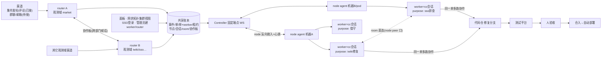
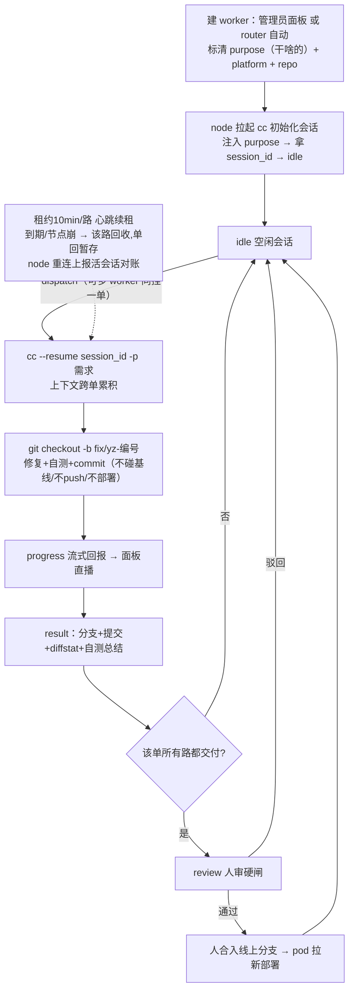
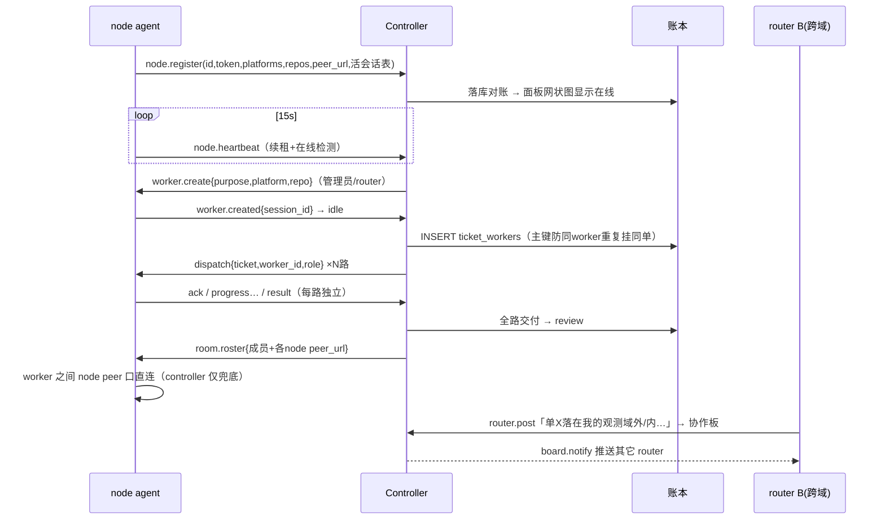
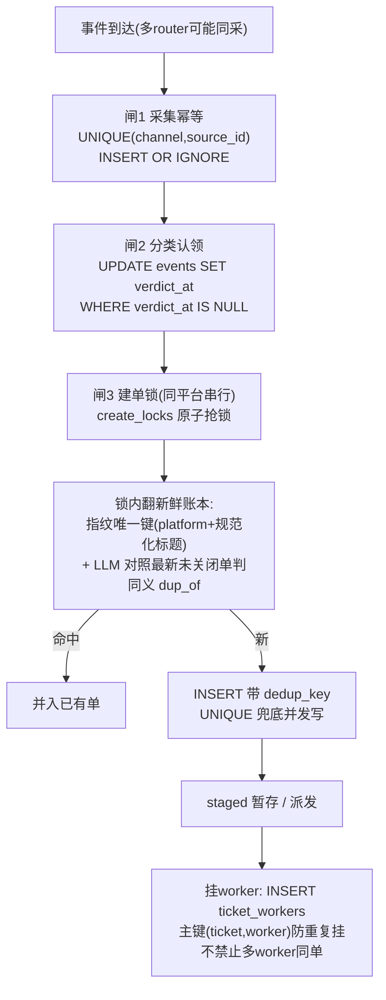

# 雁阵 · Super Agent 设计（图说版）

> v4 · 2026-11-17 · yanzhen.ssemarket.cn · 代码 /root/yanzhen · 包 v0.3.0 · 前身方案见父文档
> 一句话：router 读需求建单 → controller 派单 → **节点上的 Claude 会话（worker）**改代码 → 人验收。
> 三个执行体：**router**=独立可观测域（数量少，跨部门靠协作板交流）；**node**=机器/pod 常驻 agent（心跳自动检测在线）；**worker**=node 上的一个 cc 会话（purpose=使命，`--resume` 续上下文）。
> 一张单可挂**多个 worker 协作**；防重只防「重复建单」和「同一 worker 重复挂同一单」，不防「多人干同一单」。

## 1. 总览



router 之间**不共享内存、只共享账本**；数量=观测域数量，跨部门协作走协作板（router_messages，挂单可回放）。

## 2. Worker 工作模式（一个会话的一生）



要点：会话单并发（忙则 nack）；node 本地持久化会话表重启不丢；权限 bypass 靠**部署隔离**兜底（root 需 IS_SANDBOX=1）；合入权永远在人手里。

## 3. 通信：node/router ↔ controller，worker ↔ worker



| 消息 | 方向 | 语义 |
|---|---|---|
| node.register / heartbeat | N↔C | 在线自动检测+续租+活会话对账 |
| router.register / heartbeat / post | R↔C | router 名册+跨部门协作板 |
| worker.create / created / destroy | C↔N | 建/毁会话（带 purpose） |
| dispatch / ack / nack / progress / result | C↔N | 多路派单与回报 |
| room.roster / room.post / room.notify | C↔N | 直连名册 / 发言落账 / 兜底转发 |
| cancel | C→N | 叫停某路或全路 |

连接模型：**node/router 主动拨 controller 固定端点**（一期 wss://yanzhen.ssemarket.cn/api/agent/channel；k8s 挂 Service super-agent-controller:9100 协议不变）；worker 直连走 node 的 peer 口（默认 9101，名册广播 peer_url）。

## 4. 防重：建单三道闸（router 不通信也防得住）



实测：双进程并发建同义单 → 只落 1 张（另一路并入）；8 并发派单 → 1 成功 7 认领失败。租约管「不丢单」，与防重互为两面。

## 5. 平台要提供的能力

| 能力 | 用途 | 现状 |
|---|---|---|
| LLM 网关（计量/审计） | router 分类、cc 内核 | ✅ 平台薄层 glm-5.3/qwen-3.8-flash |
| 论坛只读数据口 | 需求采集 | ✅ 两视图；**待加**反馈表/群聊(飞书高敏权限)/邮箱 |
| 代码仓+凭据+测试平台 | worker 改码/自测/验收 | ✅ 按平台配进 node REPO_MAP |
| UniSSO 身份 | 面板登录 | ✅ 已注册应用 app_b2244e9bebcffcfd（PKCE）；管理员=YZ_ADMIN_SUBS/EMAILS |
| 包下载站 | 节点分发 | ✅ /dl 固定地址 |
| k8s Service/持久卷/initContainer | 集群化 | ⏳ 三期；账本届时迁 PG |
| 域名+证书 | 入口 | ✅ 通配；**11-22 到期需续** |
| 隔离执行环境 | cc bypass 的安全边界 | 独立 pod/容器，只挂目标仓 |

## 6. 包与固定下载（v0.3.0 已验证）

三包内置 node 运行时，解压即跑零在线安装。已验证：SSO 登录→管理员建双会话→**双 worker 同单并行交付**→room **node 直连**发言→**跨域协作板**喊话→并发建单防重→网状拓扑 live。

- 清单 `https://yanzhen.ssemarket.cn/dl/manifest.json`
- `https://yanzhen.ssemarket.cn/dl/yanzhen-router-latest.tar.gz`
- `https://yanzhen.ssemarket.cn/dl/yanzhen-worker-latest.tar.gz`（node agent）
- `https://yanzhen.ssemarket.cn/dl/yanzhen-kernel-cc-latest.tar.gz`

```sh
curl -O https://yanzhen.ssemarket.cn/dl/yanzhen-worker-latest.tar.gz
curl -O https://yanzhen.ssemarket.cn/dl/yanzhen-kernel-cc-latest.tar.gz
tar xzf yanzhen-worker-latest.tar.gz && tar xzf yanzhen-kernel-cc-latest.tar.gz
cd yanzhen-worker && cp worker.env.example worker.env  # TOKEN/NODE_ID/PLATFORMS/REPO_MAP/PEER_PORT
./start.sh   # 自动上线；worker 会话由管理员/router 在其上创建
```

面板：落地页燕子入场（免登录）→ SSO 登录 → 集群网状图（router◆/node⬡/worker● + 派单/room/协作板/lineage 边，SSE live）；**建 worker/router 仅管理员**；验收所有登录用户可操作。

## 7. 本机受限 worker（守卫四件套，已运行）

本机 systemd `yanzhen-node.service` 跑 node agent（n-market-host），router 自动在其上建会话接暂存单。限制：

| 守卫 | 实现 | 防什么 |
|---|---|---|
| 沙箱副本仓 | /root/yanzhen-sandbox/* 为真实仓的 local clone；worker 只改副本 | 改崩线上代码 |
| 每会话独立 worktree | wt-<worker_id>，git worktree 隔离 | 多会话互踩分支/工作区 |
| cc 工具白名单 | --permission-mode acceptEdits + --allowedTools（Read/Edit/Write/git/测试类）；rm/系统/网络写命令自动 deny；容器内显式 WORKER_FULL_BYPASS=1 才全 bypass | 危险命令 |
| cgroup 资源笼 | MemoryMax=3G CPUQuota=150% TasksMax=400 | 跑崩机器 |

加上既有：仅修复分支、不 push 不部署、人审硬闸。实测 6 单并行交付进 review，真实仓 porcelain=0。

## 8. 前端工程（可维护框架）

Vue 3 + Vite + vue-router（hash 模式：一视图一 URL、实体深链 /tickets/:id /worker/:id /node/:id /router/:id /room/:id，**刷新/分享还原现场**）；组件化：SkyCanvas（程序燕子）/MeshGraph（力导网状图，冷却收敛+视觉签名保 DOM 稳定可点，pointer-events:bounding-box 命中）/EntityDrawer（运行状态 live+下发命令全量+关联跳转）/TicketDrawer（多选派发/验收）/七视图；SSE composable 驱动 live。源码 web/，打包时 vite build 进包 public/，解压即跑不变。
